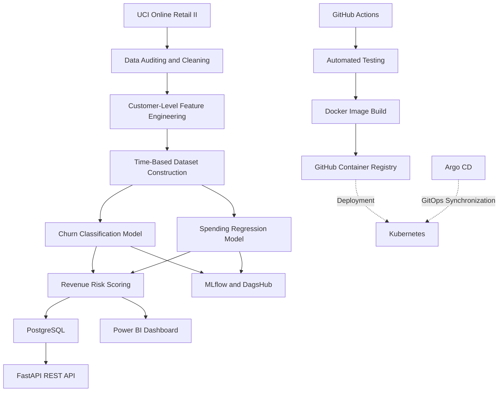

# Customer Retention & Revenue Risk

An end-to-end data science and machine learning project that predicts customer churn, estimates revenue exposure, and translates model predictions into actionable customer retention priorities.

The project integrates data engineering, predictive modeling, experiment tracking, database management, REST API development, containerization, automated testing, and business intelligence.

## 1. Business Problem

Customer inactivity can lead to significant revenue loss. However, prioritizing customers based solely on churn probability may overlook customers with substantial financial value.

This project addresses four business questions:

- Which customers are unlikely to make another purchase within 90 days?
- How much could each customer spend if they return?
- How much potential revenue is exposed to customer churn?
- Which customers should the retention team prioritize?

## 2. Project Results

| Business Metric | Result |
|---|---:|
| Customers evaluated | 5,281 |
| Average predicted churn probability | 65.7% |
| Estimated 90-day revenue at risk | £1.95 million |
| Expected 90-day revenue | £1.86 million |
| Churn model test ROC-AUC | 0.8050 |
| Churn model test recall | 96.86% |
| Churn model test F1-score | 0.7756 |
| Spending model test R² | 0.5487 |

Revenue at risk represents estimated financial exposure, not guaranteed revenue loss or revenue recoverable through a marketing intervention.

## 3. Technology Stack

| Component | Technology |
|---|---|
| Programming | Python, SQL |
| Data processing | Pandas, NumPy |
| Machine learning | XGBoost, Scikit-learn |
| Experiment tracking | MLflow, DagsHub |
| Database | PostgreSQL |
| Backend | FastAPI, Uvicorn |
| Business intelligence | Power BI |
| Testing | Pytest |
| Containerization | Docker, Docker Compose |
| Continuous integration | GitHub Actions |
| Container registry | GitHub Container Registry |
| Deployment | Kubernetes, Argo CD |
| Version control | Git, GitHub |

## 4. System Architecture



The current Power BI report consumes the generated prediction dataset. PostgreSQL and FastAPI provide a separate database-backed serving layer.

## 5. Dataset

The project uses the [UCI Online Retail II dataset](https://archive.ics.uci.edu/dataset/502/online+retail+ii), containing historical transactions from a UK-based online retailer.

| Dataset Characteristic | Value |
|---|---|
| Original transaction records | 1,067,371 |
| Observation period | December 2009 – December 2011 |
| Source worksheets | 2 |
| Currency | GBP |
| Cleaned customer orders | 36,969 |
| Prediction horizon | 90 days |

### Data Quality and Preprocessing

The preprocessing pipeline includes:

- Missing customer identifier detection and removal.
- Cancellation and return handling.
- Removal of invalid quantities and prices.
- Transaction date validation.
- Cross-worksheet duplicate detection.
- Preservation of legitimate repeated purchases.
- Aggregation of transaction lines into customer orders.

Raw datasets remain unchanged and are excluded from version control.

## 6. Feature Engineering

Twenty-four customer-level behavioral features were constructed using historical transactions.

Feature groups include:

| Feature Group | Description |
|---|---|
| Recency | Time since the customer's most recent purchase |
| Tenure | Length of the customer's purchasing history |
| Frequency | Historical order count and shopping frequency |
| Monetary value | Total spending and average order value |
| Purchase intervals | Average, median and variability of purchase gaps |
| Behavioral changes | Time since purchase relative to historical purchase patterns |
| Rolling activity | Order counts and spending over 30, 60, 90, 180 and 365 days |

Features are calculated using only information available at each prediction date.

Customer identifiers are excluded from model training.

## 7. Churn Definition and Evaluation Design

A customer is classified as churned if they make no purchase during the 90 days following a prediction date.

- Churn = 1: No purchase within the next 90 days.
- Churn = 0: At least one purchase within the next 90 days.

This definition represents purchase inactivity rather than confirmed permanent customer departure.

### Time-Based Dataset Splitting

| Dataset | Prediction Period | Samples |
|---|---|---:|
| Training | July 2010 – March 2011 | 38,794 |
| Validation | June 12, 2011 | 4,976 |
| Testing | September 10, 2011 | 5,281 |

Training, validation and testing use chronological prediction dates with non-overlapping target observation periods across the splits.

Customers may appear in multiple historical snapshots, reflecting repeated scoring of existing customers in a real retention system.

The final test dataset is excluded from model selection and threshold optimization.

## 8. Customer Churn Prediction

An XGBoost classification model estimates the probability that a customer will make no purchase within the next 90 days.

The final model was trained using the combined training and validation datasets after model selection.

### Test Performance

| Metric | Result |
|---|---:|
| ROC-AUC | 0.8050 |
| Precision | 0.6468 |
| Recall | 0.9686 |
| F1-score | 0.7756 |
| Classification threshold | 0.40 |

The classification threshold was selected using validation performance rather than test results.

High recall supports the business objective of identifying customers who may require retention attention.

## 9. Customer Spending Prediction

A separate XGBoost regression model estimates potential 90-day spending conditional on a customer returning.

The model is trained on customers who made purchases during their corresponding future observation periods.

### Test Performance

| Metric | Result |
|---|---:|
| Mean Absolute Error | £680.83 |
| Root Mean Squared Error | £3,289.77 |
| R² | 0.5487 |
| Total predicted spending | £2,200,736 |
| Total observed spending | £2,868,162 |
| Aggregate prediction error | -23.27% |

The regression model captures variation in customer spending but underestimates aggregate spending on the holdout dataset.

## 10. Revenue Risk Estimation

The classification and regression models are combined to produce customer-level financial risk estimates.

Let:

- P = predicted probability of churn.
- S = estimated 90-day spending conditional on returning.

### Revenue at Risk

Revenue at Risk = P × S

### Expected Revenue

Expected Revenue = (1 − P) × S

These calculations allow customers to be prioritized according to both churn probability and estimated financial value.

### Highest Revenue Risk Customers

| Customer ID | Estimated Revenue at Risk |
|---|---:|
| 12346 | £12,648.70 |
| 13666 | £9,577.70 |
| 15098 | £8,548.83 |
| 17763 | £8,425.98 |
| 18227 | £6,802.96 |

A customer with a relatively low churn probability may still warrant attention if their estimated spending is sufficiently high.

The risk score is a model-based prioritization measure, not a causal estimate of revenue that a retention campaign would recover.

## 11. Experiment Tracking

MLflow and DagsHub are used to track model development and evaluation.

Tracked information includes:

- Model hyperparameters.
- Training and validation results.
- Test evaluation metrics.
- Trained model artifacts.
- Experiment configurations.

[View MLflow experiments on DagsHub](https://dagshub.com/Omesham/customer-retention-revenue-risk)

## 12. PostgreSQL Database

Customer-level predictions are stored in PostgreSQL.

The customer_revenue_risk table contains:

| Column | Description |
|---|---|
| customer_id | Unique customer identifier |
| scoring_date | Prediction date |
| churn_probability | Predicted probability of inactivity |
| estimated_90d_spend | Estimated spending conditional on returning |
| revenue_at_risk_90d | Estimated financial exposure |
| expected_90d_revenue | Probability-weighted expected revenue |
| created_at | Record creation timestamp |

The database uses a composite primary key consisting of customer ID and scoring date to prevent duplicate prediction records.

Database credentials are managed through environment variables rather than committed to the repository.

## 13. FastAPI REST API

The FastAPI backend provides access to stored customer predictions and aggregated business metrics.

| Method | Endpoint | Description |
|---|---|---|
| GET | /health | Application and database health |
| GET | /customers | Paginated customer predictions |
| GET | /customers/{customer_id} | Individual customer prediction history |
| GET | /revenue-risk/top | Highest revenue risk customers |
| GET | /summary | Aggregated retention and revenue metrics |

The backend includes input validation, structured logging, exception handling and database connectivity checks.

Interactive API documentation is available through Swagger UI when the backend is running.

## 14. Power BI Dashboard

The Customer Retention and Revenue Risk Dashboard translates model predictions into business insights.

Dashboard components include:

- Total customers evaluated.
- Estimated 90-day revenue at risk.
- Expected 90-day revenue.
- Average churn probability.
- Top 10 customers by revenue at risk.
- Customer churn risk distribution.
- Customer retention priority table.

### Business Risk Segmentation

| Category | Predicted Churn Probability |
|---|---|
| Low | Below 30% |
| Medium | 30% to below 70% |
| High | 70% and above |

These dashboard segmentation thresholds are business-defined and are separate from the model's classification threshold.

[Download the Power BI report](reports/customer_retention_dashboard.pbix)

## 15. Docker and Continuous Integration

The FastAPI backend and PostgreSQL database are containerized using Docker and Docker Compose.

The FastAPI Docker image uses a lightweight Python base image and a dedicated API dependency file, avoiding unnecessary machine learning dependencies in the serving environment.

GitHub Actions automates:

1. Repository checkout.
2. Python environment configuration.
3. Dependency installation.
4. Automated testing.
5. Docker image construction.
6. Container image publication to GitHub Container Registry.

Container images are versioned using Git commit identifiers.

[View GitHub Actions workflows](https://github.com/Omesham/customer-retention-revenue-risk/actions)

## 16. Kubernetes and GitOps

Kubernetes manifests are provided for:

- Application namespace.
- FastAPI deployment and service.
- PostgreSQL deployment and service.
- Persistent database storage.
- Application configuration.
- Health and readiness checks.

Argo CD is used for GitOps-based deployment synchronization.

The initial local Kubernetes deployment and API connectivity were demonstrated. Final deployment verification on the home environment and automated image-version updates remain in progress.

## 17. Repository Structure

```text
customer-retention-revenue-risk/
├── .github/workflows/     # Continuous integration
├── data/
│   ├── raw/               # Original datasets
│   └── processed/         # Engineered datasets
├── k8s/                   # Kubernetes manifests
├── models/                # Local trained model artifacts
├── reports/               # Predictions and Power BI dashboard
├── scripts/               # Data and model pipeline entry points
├── sql/                   # PostgreSQL schema
├── src/
│   └── retention_lab/     # Core project modules
│       └── api/           # FastAPI backend
├── tests/                 # Automated tests
├── .env.example           # Environment configuration template
├── .gitignore
├── compose.yaml
├── Dockerfile
├── requirements-api.txt
├── requirements.txt
└── README.md
```

## 18. Getting Started

### Clone the Repository

```bash
git clone https://github.com/Omesham/customer-retention-revenue-risk.git
cd customer-retention-revenue-risk
git checkout development
```

### Configure the Python Environment

Python 3.12 is recommended to match the CI and container environments.

```powershell
python -m venv .venv
.venv\Scripts\Activate.ps1
python -m pip install -r requirements.txt
```

### Download and Audit the Dataset

```bash
python scripts/download_datasets.py
python scripts/audit_datasets.py
```

### Construct the Modeling Datasets

```bash
python -m scripts.build_snapshot_dataset
python -m scripts.build_spending_dataset
```

### Train the Models

```bash
python -m scripts.final_snapshot_xgboost
python -m scripts.final_spending_model
```

Configure MLflow authentication before running the experiment-tracking scripts.

### Generate Revenue Risk Predictions

```bash
python -m scripts.final_revenue_risk
```

Ensure the revenue scoring script references the trained model artifacts from the appropriate experiment runs.

The resulting predictions are stored in:

```text
reports/final_revenue_at_risk.csv
```

### Configure Environment Variables

Create a local .env.dev file using .env.example as a template.

Provide the required PostgreSQL credentials and application configuration.

Do not commit environment files containing credentials.

### Start Docker Services

```bash
docker compose --env-file .env.dev up -d --build
```

Load the generated predictions into PostgreSQL using the database loading script:

```text
scripts/load_revenue_risk.py
```

With the development API port configured as 8001, access:

- Swagger UI: http://localhost:8001/docs
- Health check: http://localhost:8001/health
- Revenue summary: http://localhost:8001/summary

### Run Automated Tests

```bash
python -m pytest tests/ -v
```

## 19. Project Status

- [x] Data acquisition and quality auditing
- [x] Data cleaning and preprocessing
- [x] Customer-level feature engineering
- [x] Time-based dataset construction
- [x] Churn classification
- [x] Customer spending regression
- [x] Model evaluation
- [x] MLflow experiment tracking
- [x] Revenue risk estimation
- [x] PostgreSQL integration
- [x] FastAPI backend
- [x] Docker containerization
- [x] Automated testing
- [x] GitHub Actions continuous integration
- [x] Container registry integration
- [x] Power BI dashboard
- [x] Kubernetes deployment manifests
- [x] Initial local Kubernetes deployment
- [ ] Final automated continuous deployment verification

## 20. Attribution

Daqing Chen (2012). Online Retail II.
UCI Machine Learning Repository.

DOI: https://doi.org/10.24432/C5CG6D

Dataset license: CC BY 4.0.